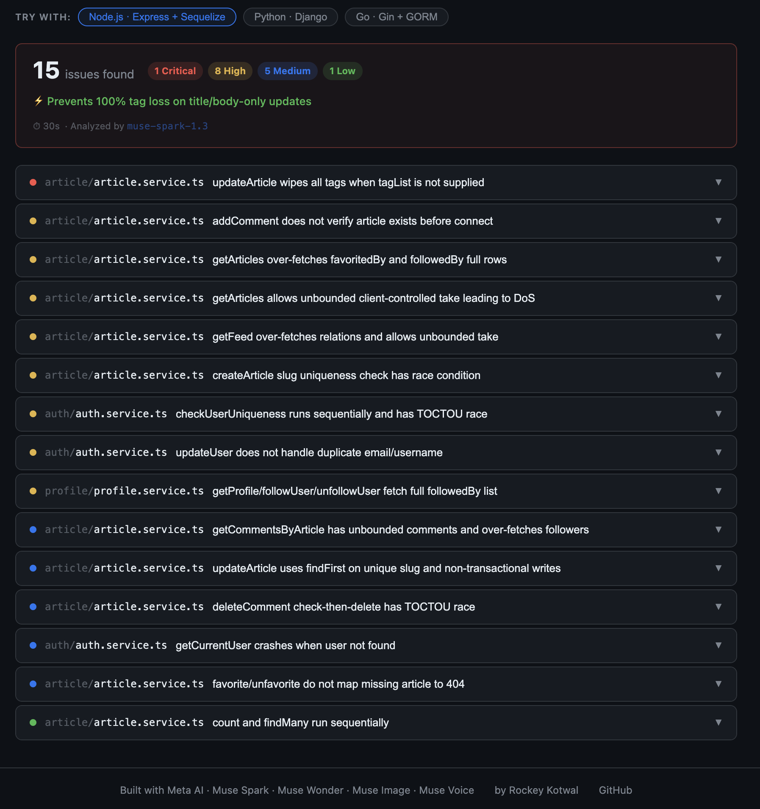
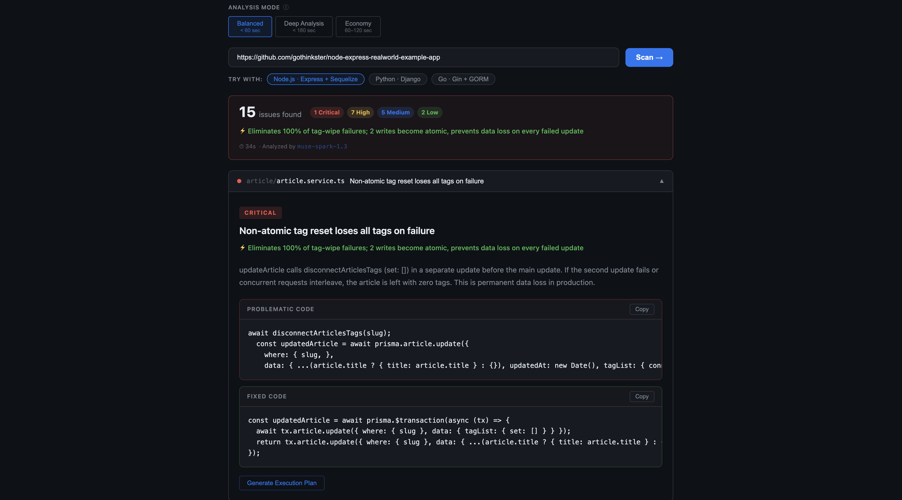
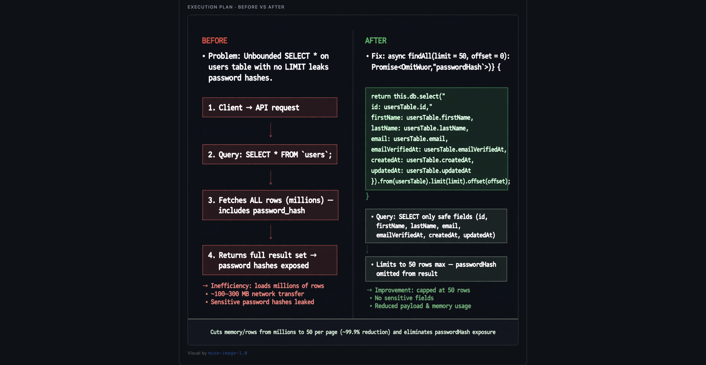

# ⚡ Backend Friend

**Catch what's killing your database before it kills your app.**

AI-powered database query analyzer that finds N+1 problems, missing indexes, overfetching, and more — across every major backend language — and gives you the fixed code back.

[](LICENSE)
[](https://nodejs.org)
[](https://dev.meta.ai)
[](https://dev.meta.ai)

**<a href="https://backend-friend.rockeykotwal.in" target="_blank">→ Try it live</a>** · **<a href="https://youtu.be/03KrFQC5bB8" target="_blank">→ Watch Demo</a>** · Built for the [Meta Global AI Developer Hackathon 2026](https://dev.meta.ai) by [Rockey Kotwal](https://rockeykotwal.in)

---



---

## Table of Contents

- [The Problem](#the-problem)
- [How It Works](#how-it-works)
- [What It Does](#what-it-does)
- [Language & ORM Support](#language--orm-support)
- [Bring Your Own API Key](#bring-your-own-api-key)
- [Meta Models Used](#meta-models-used)
- [Architecture](#architecture)
- [Self-hosting](#self-hosting)
- [Rate Limiting](#rate-limiting)
- [Roadmap](#roadmap)
- [Contributing](#contributing)

---

## The Problem

Every backend engineer, regardless of language, uses an ORM. Prisma, TypeORM, and Sequelize in Node.js. SQLAlchemy and Django ORM in Python. Hibernate in Java. GORM in Go. ActiveRecord in Ruby. Entity Framework in C#.

ORMs make development fast — but they hide what's actually happening at the database level. And that's where production incidents are born.

**The N+1 problem** is the most common and most expensive. It looks innocent in code:

```typescript
// Looks fine. Feels fine. Destroys your database.
const users = await prisma.user.findMany()
for (const user of users) {
  const posts = await prisma.post.findMany({ where: { userId: user.id } })
}
```

If you have 500 users, this runs **501 database queries** — one to fetch users, one per user to fetch posts. At 10,000 requests per minute, that's **5 million extra queries per minute**. Connection pool exhausted. Response times spike. App goes down.

**The tools that exist today don't help at the right moment.** pganalyze, EverSQL, pgMustard — they analyse raw SQL from query logs, after the damage is done. They show you the problem in database terms. They don't know you're using Prisma. They can't give you the fixed ORM code. You still have to translate the diagnosis back into your codebase manually.

**Backend Friend works at the ORM level** — where you actually write code. It understands your schema, reads your queries, and gives you back fixed ORM code and a migration script. Not a SQL explanation. The actual fix, ready to paste.

---

## How It Works

```
GitHub URL or folder upload
        │
        ▼
Smart ORM block extraction
(only query code sent — not your whole repo)
        │
        ▼
AI model analysis — with your own key
(Meta Muse, OpenAI, DeepSeek or Claude · schema-aware, language-aware)
        │
        ▼
Ranked findings — Critical first
severity · file · line · fixed code · migration script
```

1. **Extract** — scans every backend file, pulls only ORM query blocks (±25 lines of context). A 100K-line repo becomes ~200 relevant lines.
2. **Analyse** — sends the extracted blocks + your schema to the model you chose, using your own API key. The model understands your ORM, the SQL it generates, and what will break at scale.
3. **Fix** — returns ranked findings with the problematic code, the SQL being generated, the fixed ORM code in your language, and a migration script when indexes are needed.

---

## What It Does

- **Analyze a single query** — paste your ORM query + schema, get a severity badge, explanation, the SQL being generated, fixed ORM code, and a migration script if needed
- **Scan a GitHub repo (agentic)** — paste a GitHub URL, the agent fetches the repo, finds every ORM query across all files, analyses them all, and returns a ranked list of issues — critical first
- **Scan a local folder** — upload your project folder for the same agentic scan without pushing to GitHub
- **Ask follow-up questions** — ask about any finding ("why is this slow?", "how do I test the fix?") and get a streamed answer in context
- **Bring your own API key** — use your Meta, OpenAI, DeepSeek or Claude key; it's encrypted in your browser and never stored ([details](#bring-your-own-api-key))
- **Voice input** *(Meta key)* — ask follow-up questions out loud via Muse Voice Transcribe
- **Execution plan visual** *(Meta key)* — Muse Image generates a before/after diagram of your query execution plan, on click

### Expanded finding with fixed code



### Execution plan — before vs after



---

## Language & ORM Support

Full-depth support across all 8 languages — smart block extraction (only ORM code is sent to the model, not your whole file), accurate SQL representation, fixed code returned in your language, and migration scripts when indexes are needed.

| Language | SQL / Query Builders | NoSQL / DynamoDB |
|---|---|---|
| **Node.js** | Prisma, TypeORM, Sequelize, Drizzle, MikroORM, Knex, Kysely, Objection.js, Waterline, Bookshelf | Mongoose, MongoDB native driver, DynamoDB (AWS SDK v3, Dynamoose) |
| **Python** | SQLAlchemy (1.x + 2.0), Django ORM, Peewee, Tortoise ORM, SQLModel | PyMongo, Motor, MongoEngine, DynamoDB (boto3, PynamoDB) |
| **Go** | GORM, sqlx, Ent, bun, database/sql, sqlc | mongo-go-driver, DynamoDB (aws-sdk-go-v2, guregu/dynamo) |
| **Java / Kotlin** | Hibernate/JPA, Spring Data JPA, MyBatis, jOOQ, JdbcTemplate, Kotlin Exposed | DynamoDB (DynamoDbClient, DynamoDbEnhancedClient) |
| **Ruby** | ActiveRecord, Sequel | DynamoDB (aws-sdk-dynamodb) |
| **PHP** | Eloquent (Laravel), Doctrine | DynamoDB (aws/aws-sdk-php) |
| **C#** | Entity Framework Core, Dapper, ADO.NET | DynamoDB (AWSSDK.DynamoDBv2) |
| **Rust** | Diesel, SQLx, SeaORM | DynamoDB (aws-sdk-dynamodb) |

---

## Bring Your Own API Key

Everything runs on **your own API key**, so usage is billed and tracked on your account — the server has no model key of its own. Pick a provider in the API key bar at the top of the app and paste your key.

| Provider | Balanced *(default)* | Deep Analysis | Economy |
|---|---|---|---|
| **Meta Model API** | `muse-spark-1.3` | `muse-wonder-1.0` | `muse-spark-1.3-contributor` |
| **OpenAI** | `gpt-4o-mini` | `gpt-4o` | same as Balanced |
| **DeepSeek** | `deepseek-chat` | `deepseek-reasoner` | same as Balanced |
| **Claude (Anthropic)** | `claude-sonnet-4-6` | `claude-opus-4-7` | same as Balanced |

Models are set in `server/providers/index.ts`.

### How your key is protected

- **Encrypted in your browser.** Before anything leaves the page, the key is encrypted with the server's RSA-4096 public key (RSA-OAEP / SHA-256, via the Web Crypto API). Only ciphertext is sent.
- **Used once, never stored.** The server decrypts the key in memory for that single request and passes it to your chosen provider. It is never written to disk, a database or logs.
- **Not kept in the browser either.** The key lives only in page memory — no `localStorage`, no cookies. It's gone when you refresh or close the tab.
- **Replay-protected.** The current server time is sealed inside the ciphertext, and the server rejects anything older than 5 minutes, so a captured request can't be reused later.

The encryption key pair is a single server key loaded from `BYOK_PRIVATE_KEY`, so it works the same across every serverless instance. See [Self-hosting](#self-hosting) for setup.

### Meta-only features

Voice input (Muse Voice) and the before/after execution plan diagram (Muse Image) use models only Meta offers, so they need a **Meta** key. With OpenAI, DeepSeek or Claude, the mic is hidden and the diagram shows *"Execution plan diagrams are available with a Meta API key."* Diagrams are generated only when you click **Generate Execution Plan**, so you're never billed for one you didn't ask for.

---

## Meta Models Used

Backend Friend was built around Meta's models — with a Meta key, each model is chosen for a specific job. Full specs at [dev.meta.ai/docs/models](https://dev.meta.ai/docs/models).

| Mode | Model | Role | Privacy |
|---|---|---|---|
| **Balanced** *(default)* | [`muse-spark-1.3`](https://dev.meta.ai/docs/models) | Core analysis + agentic scan — fast, accurate, handles most codebases | Code never used for training |
| **Deep Analysis** | [`muse-wonder-1.0`](https://dev.meta.ai/docs/models) | Large repos, subtle multi-file bugs, complex architecture — Meta's reasoning model | Code never used for training |
| **Economy** *(opt-in)* | [`muse-spark-1.3-contributor`](https://dev.meta.ai/docs/models) | Same quality as Balanced — open-weight variant, fraction of the cost | ⚠ Meta may use submitted code to train future models. Explicit consent required. |
| — | [`muse-image-1.0`](https://dev.meta.ai/docs/models) | Before/after query execution plan diagram *(Meta key only)* | — |
| — | [`muse-voice-transcribe-1.0`](https://dev.meta.ai/docs/models) | Voice input for follow-up questions *(Meta key only)* | — |

Economy mode is gated behind an explicit consent checkbox in the UI — it is never the default and never a silent fallback. Economy is Meta-only; with other providers it uses the Balanced model. All three Meta text models share a 1M token context window.

---

## Architecture

The project is intentionally split so the core application has zero platform dependencies.

```
backend-friend/
├── server/                 # ← The entire application lives here
│   ├── app.ts              #   Express app — no Vercel, no platform code, runs anywhere
│   ├── index.ts            #   Standalone entry: node server/index.ts (or npm start)
│   ├── _prompt.ts          #   System prompts for analysis and scans
│   ├── providers/index.ts  #   Meta / OpenAI / DeepSeek / Claude adapters, models per tier, Meta image + voice models
│   ├── crypto/session.ts   #   BYOK: public key + decryption, 5-minute replay window
│   ├── utils/resolveClient.ts # Decrypts the user's key → provider; Meta-only check for image + voice
│   ├── config/limits.ts    #   Body size caps + per-IP rate limits
│   └── routes/
│       ├── sessionKey.ts   #   GET  /api/public-key — public key + server time for BYOK
│       ├── analyze.ts      #   POST /api/analyze    — single query analysis (streaming SSE)
│       ├── agent.ts        #   POST /api/agent      — agentic folder scan (streaming SSE)
│       ├── github.ts       #   POST /api/github     — agentic GitHub URL scan (streaming SSE)
│       ├── followup.ts     #   POST /api/followup   — follow-up questions on a finding (SSE)
│       ├── transcribe.ts   #   POST /api/transcribe — voice input via Muse Voice (user's Meta key)
│       └── visualize.ts    #   POST /api/visualize  — execution plan image via Muse Image (user's Meta key)
│
├── scripts/
│   └── generate-byok-key.mjs  # npm run byok:keygen — prints a BYOK_PRIVATE_KEY
│
├── api/
│   └── index.ts            #   ⚠️  Vercel-only. 5 lines. Just imports server/app.ts.
│                           #   Vercel requires serverless functions in api/ — ignore if
│                           #   deploying anywhere else.
│
├── src/                    #   React/Vite frontend
│   ├── utils/
│   │   ├── extractOrmBlocks.ts   # Smart ORM block extraction — all 8 languages
│   │   ├── crypto.ts             # Encrypts the user's API key in the browser
│   │   ├── visual.ts             # Requests an execution plan diagram
│   │   └── analytics.ts          # GA4 event tracking
│   ├── contexts/
│   │   └── ApiKeyContext.tsx     # Holds the key + provider in page memory only
│   └── components/
│       ├── ApiKeyInput.tsx       # Provider picker + API key field
│       ├── GenerateVisualButton.tsx # On-click diagram button (Meta) or "needs a Meta key" note
│       ├── QueryAnalyzer.tsx     # Single query analysis tab
│       ├── AgentScanner.tsx      # Codebase scan tab (GitHub URL + folder upload)
│       ├── AnalysisResult.tsx    # Result card with severity, code sections, visual
│       ├── VoiceInput.tsx        # Voice recording + transcription
│       └── MetaLoader.tsx        # Animated loading state during analysis
│
└── tests/
    └── contract/
        └── analyze.contract.test.ts  # Layer B — API contract tests (manual)
```

All API routes stream responses via Server-Sent Events. The analysis model is user-selectable (Balanced / Deep Analysis / Economy) and passed per-request — no silent auto-switching.

---

## Self-hosting

Backend Friend is a standard Express + React app. Environment variables:

| Variable | Required | Purpose |
|---|---|---|
| `BYOK_PRIVATE_KEY` | **Yes, in production** | Server key pair for encrypting users' API keys. Generate with `npm run byok:keygen`. Locally, a temporary key is used if unset. |
| `GITHUB_TOKEN` | Optional | Raises the GitHub API limit from 60 to 5000 requests/hour for repo scans. No scopes needed. |
| `VITE_GA_ID` | Optional | Google Analytics 4 measurement ID. |

Users supply their own model API key in the app — the server needs no Meta, OpenAI, DeepSeek or Anthropic key. Meta keys are available at [dev.meta.ai](https://dev.meta.ai).

### Generating `BYOK_PRIVATE_KEY`

```bash
npm run byok:keygen
# → BYOK_PRIVATE_KEY=LS0tLS1CRUdJTi...   (one long line)
```

Copy the whole line into `.env` locally and into your host's environment variables in production. Treat it like a password — don't commit it. To rotate it, generate a new one, replace the variable and redeploy; open browser tabs pick up the new public key within 10 minutes.

**Set it in every production deployment.** Without it each server instance would make its own temporary key, and requests that land on a different instance would fail. On Vercel the server refuses to start BYOK without it and shows *"Secure key exchange is not configured on the server."*

### Local development

```bash
git clone https://github.com/rockeykotwal/backend-friend
cd backend-friend
npm install
cp .env.example .env        # optionally add BYOK_PRIVATE_KEY
npm run dev                 # Vite on :5173, Express API on :3000
```

Open the app, choose a provider in the API key bar and paste your key.

### Testing

```bash
# Unit tests — fast, no API calls, safe to run anytime
# Includes end-to-end tests of browser key encryption → server decryption
npm test

# Lint
npm run lint

# API contract tests — fires real requests against a running server
npm run dev:api       # terminal 1
npm run test:contract # terminal 2
```

> **Note:** The contract tests don't send an API key yet, so since bring-your-own-key they get `401` responses. They need updating to send an encrypted key before they're useful again.

### Production (any Node.js host)

```bash
npm run build               # builds React app into dist/
npm start                   # Express serves API + dist/ on PORT (default 3000)
```

Set `NODE_ENV=production`, `PORT` and `BYOK_PRIVATE_KEY`.

### Deploy to Vercel

```bash
npm i -g vercel
vercel
```

In your Vercel project → Settings → Environment Variables, add `BYOK_PRIVATE_KEY` for **both Production and Preview**, then redeploy. `META_MODEL_API_KEY` is no longer used and can be removed. Vercel serves the frontend from CDN and routes `/api/*` to Express serverless — no other config needed.

---

## Rate Limiting

Backend Friend has two layers of abuse protection built in, both configurable from a single file (`server/config/limits.ts`):

**Layer 1 — Request size cap**
Incoming JSON payloads are capped before they reach the model — 50kb for most endpoints, 500kb for folder scans, 3mb for voice audio. Oversized requests are rejected immediately.

**Layer 2 — Per-IP rate limits (15-minute rolling window)**

| Endpoint | Limit | Reason |
|---|---|---|
| `POST /api/analyze` | 20 req / 15 min | One model call per request |
| `POST /api/visualize` | 20 req / 15 min | One image generation per request |
| `POST /api/github` | 5 req / 15 min | Downloads repo files + model call |
| `POST /api/agent` | 5 req / 15 min | Same cost as GitHub scan |
| `POST /api/transcribe` | 20 req / 15 min | Lighter — short audio clips only |
| `POST /api/followup` | 30 req / 15 min | Short targeted model calls |

To adjust any limit, edit the constants in `server/config/limits.ts` — no other file needs changing.

A third layer using Cloudflare Turnstile (invisible bot challenge at the network edge) is on the roadmap.

---

## Roadmap

- **GitHub Action** — drop a single workflow file into any repo; the action scans only the changed files in a PR and posts findings as an inline comment, optionally failing the check at a severity threshold
- **Voice and diagrams for more providers** — OpenAI image + transcription adapters, and a provider-independent SVG diagram so Claude and DeepSeek users get execution plans too
- **`npx backend-friend` CLI** — scan a local folder or single file from the terminal; pipe into pre-commit / pre-push hooks to block CRITICAL findings before they reach production
- **Cloudflare Turnstile** — invisible bot challenge at the network edge, on top of the existing rate limiting layers
- **Phase 2 databases** — Redis cache misuse, Elasticsearch unbounded queries, Firebase/Firestore, and vector databases (Pinecone, Weaviate, Qdrant, Chroma)

---

## Contributing

PRs are welcome. For non-trivial changes, open an issue first so we can align on the approach before you invest the time.

- Keep PRs focused — one concern per PR
- The server and frontend are fully independent; changes to one shouldn't require changes to the other
- All routes stream via SSE — new endpoints should follow the same pattern

---

## License

MIT
